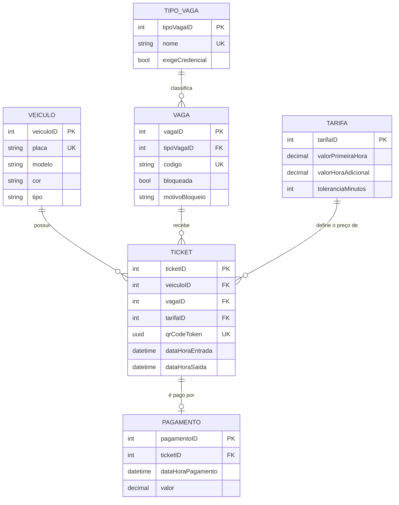

<h1 align="center">🚗 SmartPark</h1>

<p align="center">
  API REST para controle de estacionamento de shopping: entrada, permanência, pagamento e saída de veículos.
</p>

<p align="center">
  
  
  
  
  
</p>

---

## 📚 Sobre o projeto

Projeto prático da disciplina **Programação I** do **Instituto Federal de Sergipe (IFS)**, ministrada pelo **Prof.
Glauco Carvalho** (60h/aula).

O objetivo é construir, por partes, uma API REST com fluxo completo de negócio:

```
Entrada do veículo → Ticket com QR Code → Cálculo da permanência → Pagamento → Saída liberada → Vaga disponível
```

---

## 🛠️ Tecnologias

| Tecnologia                      | Uso no projeto                                            |
|---------------------------------|-----------------------------------------------------------|
| **Java 21**                     | linguagem, com `record` nos DTOs                          |
| **Spring Boot 4.1.1**           | base da aplicação (Web MVC)                               |
| **Spring Data JPA / Hibernate** | mapeamento das entidades e consultas                      |
| **H2 Database**                 | banco de dados em memória                                 |
| **Bean Validation**             | validação dos dados de entrada (`@NotBlank`, `@Pattern`…) |
| **Lombok**                      | geração de getters, setters e construtores                |
| **springdoc-openapi 3.2.0**     | documentação e testes pelo Swagger                        |
| **Maven**                       | gerenciamento de dependências e build                     |

---

## 📋 Regras de negócio

- Um veículo **não pode ter dois tickets abertos** ao mesmo tempo.
- Uma vaga **ocupada ou bloqueada** não pode ser utilizada.
- Todo ticket possui **entrada, veículo, vaga, tarifa** e um **QR Code** (token UUID).
- **Até 15 minutos é gratuito**; depois, cobra-se a primeira hora e cada hora adicional iniciada.
- Um ticket pago **não pode ser pago novamente**.
- A saída **só é liberada após o pagamento**, e a vaga volta a ficar disponível.

Regras complementares adotadas no projeto:

- Só existe **uma tarifa ativa** por vez: uma nova tarifa substitui a vigente, e as antigas ficam no histórico.
- Placa e código de vaga são **normalizados** (`abc-1234` → `ABC1234`) e não podem se repetir.
- Vagas ocupadas **não podem ser bloqueadas nem inativadas**.
- Os registros são **inativados**, não apagados (exclusão lógica), para preservar o histórico.

---

## 🗂️ Modelo de dados



Todas as tabelas também possuem os campos `ativo`, `dataCadastro` e `dataAtualizacao`.

---

## 🧱 Estrutura do projeto

```
src/main/java/br/com/smartpark/estacionamento
├── controller   → endpoints da API REST
├── dto
│   ├── request  → dados recebidos do cliente (records com validação)
│   └── response → dados devolvidos ao cliente (records)
├── enums        → TipoVeiculo
├── exception    → exceções de negócio e tratamento centralizado de erros
├── model        → entidades JPA
├── repository   → acesso ao banco (Spring Data JPA)
└── service      → regras de negócio
```

Cada camada é organizada em subpacotes por entidade (`veiculo`, `tipovaga`, `vaga`, `tarifa`, `ticket`, `pagamento`).

---

## ▶️ Como executar

**Pré-requisito:** Java 21 instalado. O Maven não precisa ser instalado, porque o projeto usa o Maven Wrapper.

```bash
git clone https://github.com/vic-barros/smartpark.git
cd smartpark
./mvnw spring-boot:run
```

No Windows, use `mvnw.cmd spring-boot:run`.

A aplicação sobe em `http://localhost:8080`.

| Recurso                             | Endereço                              |
|-------------------------------------|---------------------------------------|
| **Swagger** (documentação e testes) | http://localhost:8080/swagger-ui.html |
| **Console do H2**                   | http://localhost:8080/h2              |

Para acessar o console do H2, use:

- **JDBC URL:** `jdbc:h2:mem:estacionamentoDB`
- **Usuário:** `smartpark`
- **Senha:** `123`

> ⚠️ O banco H2 está **em memória**: os dados são apagados sempre que a aplicação é encerrada.

---

## 🔌 Endpoints

### Veículos — `/veiculos`

| Método   | Caminho          | Descrição                                                   |
|----------|------------------|-------------------------------------------------------------|
| `GET`    | `/veiculos`      | lista os veículos ativos (paginado: `page`, `size`, `sort`) |
| `GET`    | `/veiculos/{id}` | busca um veículo                                            |
| `POST`   | `/veiculos`      | cadastra um veículo                                         |
| `PUT`    | `/veiculos/{id}` | atualiza modelo, cor e tipo                                 |
| `DELETE` | `/veiculos/{id}` | inativa um veículo                                          |

### Tipos de vaga — `/tipos-vaga`

| Método   | Caminho            | Descrição             |
|----------|--------------------|-----------------------|
| `GET`    | `/tipos-vaga`      | lista os tipos ativos |
| `GET`    | `/tipos-vaga/{id}` | busca um tipo         |
| `POST`   | `/tipos-vaga`      | cadastra um tipo      |
| `PUT`    | `/tipos-vaga/{id}` | atualiza um tipo      |
| `DELETE` | `/tipos-vaga/{id}` | inativa um tipo       |

### Vagas — `/vagas`

| Método   | Caminho                   | Descrição                      |
|----------|---------------------------|--------------------------------|
| `GET`    | `/vagas`                  | lista as vagas ativas          |
| `GET`    | `/vagas/livres`           | lista as vagas livres          |
| `GET`    | `/vagas/ocupadas`         | lista as vagas ocupadas        |
| `GET`    | `/vagas/{id}`             | busca uma vaga                 |
| `POST`   | `/vagas`                  | cadastra uma vaga              |
| `PUT`    | `/vagas/{id}`             | atualiza código e tipo         |
| `PATCH`  | `/vagas/{id}/bloqueio`    | bloqueia a vaga (exige motivo) |
| `PATCH`  | `/vagas/{id}/desbloqueio` | desbloqueia a vaga             |
| `DELETE` | `/vagas/{id}`             | inativa uma vaga               |

### Tarifas — `/tarifas`

| Método | Caminho            | Descrição                                                |
|--------|--------------------|----------------------------------------------------------|
| `GET`  | `/tarifas`         | histórico de tarifas, da mais recente para a mais antiga |
| `GET`  | `/tarifas/vigente` | tarifa usada nas novas entradas                          |
| `GET`  | `/tarifas/{id}`    | busca uma tarifa (inclusive as antigas)                  |
| `POST` | `/tarifas`         | cadastra uma tarifa, que substitui a vigente             |

### Tickets — `/tickets`

| Método  | Caminho                        | Descrição                                                                |
|---------|--------------------------------|--------------------------------------------------------------------------|
| `POST`  | `/tickets/entrada`             | registra a entrada do veículo (placa e vaga) e gera o ticket com QR Code |
| `GET`   | `/tickets/abertos`             | lista os tickets em aberto                                               |
| `GET`   | `/tickets/{qrCodeToken}`       | consulta um ticket pelo QR Code                                          |
| `GET`   | `/tickets/{qrCodeToken}/valor` | valor a pagar no momento                                                 |
| `PATCH` | `/tickets/{qrCodeToken}/saida` | libera a saída (somente após o pagamento)                                |

### Pagamentos — `/pagamentos`

| Método | Caminho                     | Descrição                                                             |
|--------|-----------------------------|-----------------------------------------------------------------------|
| `POST` | `/pagamentos`               | paga o ticket do QR Code informado (o valor é calculado pelo sistema) |
| `GET`  | `/pagamentos/{qrCodeToken}` | comprovante do pagamento de um ticket                                 |

### Exemplo de requisição

```http
POST /veiculos
Content-Type: application/json

{
  "placa": "ABC-1234",
  "modelo": "Onix",
  "cor": "Prata",
  "tipoVeiculo": "CARRO"
}
```

Resposta `201 Created`, com o cabeçalho `Location: /veiculos/1`:

```json
{
  "veiculoId": 1,
  "placa": "ABC1234",
  "modelo": "Onix",
  "cor": "Prata",
  "tipoVeiculo": "CARRO",
  "dataCadastro": "2026-11-25T10:15:30"
}
```

---

## ⚠️ Tratamento de erros

Os erros são tratados de forma centralizada (`@RestControllerAdvice`) e devolvidos sempre no mesmo formato:

```json
{
  "timestamp": "2026-11-25T10:20:00",
  "status": 409,
  "error": "Placa já cadastrada",
  "message": "Placa ABC1234 já cadastrada.",
  "path": "/veiculos"
}
```

| Status                     | Quando ocorre                                                        |
|----------------------------|----------------------------------------------------------------------|
| `400 Bad Request`          | dados inválidos ou JSON malformado (com a lista de campos inválidos) |
| `404 Not Found`            | recurso não encontrado                                               |
| `409 Conflict`             | placa já cadastrada                                                  |
| `422 Unprocessable Entity` | regra de negócio violada                                             |

---

## 🚧 Andamento

- [x] Entidades JPA (Veículo, Tipo de Vaga, Vaga, Tarifa, Ticket, Pagamento)
- [x] Repositories com consultas derivadas e JPQL
- [x] DTOs de request e response
- [x] Tratamento centralizado de erros
- [x] Services com as regras de negócio
- [x] Controllers de Veículo, Tipo de Vaga e Vaga
- [x] Controllers de Tarifa, Ticket e Pagamento
- [ ] Geração da imagem do QR Code

---

## 👩‍💻 Autoria

Desenvolvido por **Laíssa Victória Barros** ([@vic-barros](https://github.com/vic-barros)) como atividade da disciplina
**Programação I** — IFS.

Professor: **Glauco Carvalho**
